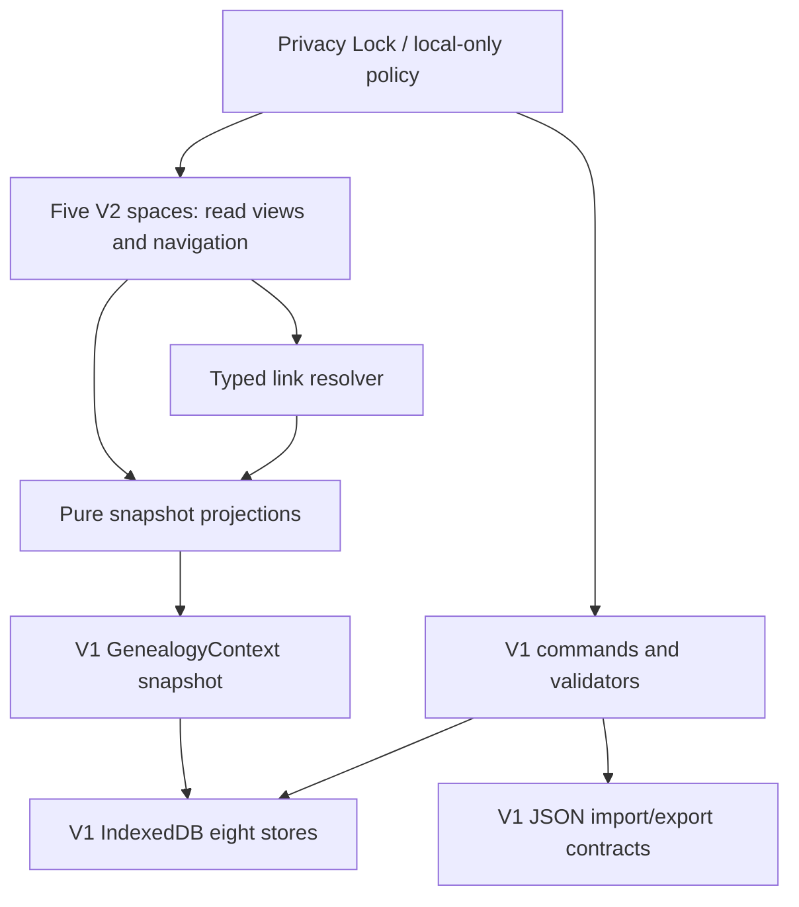

# V2 architecture options — decision proposal only

**Pinned input:** Gift Edition RC2 `7b745ebe553e6db6813ae2095d6f3bd11bc0ed97`. No UI, schema, dependency, server or business-core changes are part of this sprint.

## Option comparison

| Option | Shape | Advantages | Costs and risks | Recommendation |
| --- | --- | --- | --- | --- |
| **A. V1 core + V2 read projections** | Keep the eight stores, `GenealogyContext` mutations, validators and import/export. Build pure selector functions over a snapshot for the five proposed spaces; keep one typed link resolver. | Fastest path to connected views; V1 tests, offline model and Privacy Lock remain meaningful. Can start with no schema change. | Whole-snapshot reads, repeated linear joins, larger memory with base64 media. Need performance gates and careful invalid-reference states. | **Preferred first architecture slice after Blueprint/Golden Design approval.** |
| **B. V1 core + domain modules with versioned persistence** | Keep the same core contracts, add bounded modules and IDB stores/fields only for approved unmet needs (households, event links, provenance, permissions). | Explicit ownership and future scale without replacing graph. | Requires DB/snapshot versioning, data migration, import/export adapters, rollback plan and broader regression. | Conditional phase after A exposes real gaps and product semantics are approved. |
| **C. External genealogy platform or backend replacement** | Replace app core with AncestorTree/Gramps-style server, or external chart/data model as authority. | Potential mature research features. | Breaks local-only assumptions and requires data conversion, auth/privacy decisions, licensing and new operating model. | **Do not select in discovery.** A separate product and security decision would be required. |

## Five proposed spaces mapped to V1

These are information architecture options for the Blueprint, not implemented routes.

| V2 space | V1 pieces to reuse | Proposed read projection and likely first navigation target | Open question |
| --- | --- | --- | --- |
| **Nhà mình** | Person profile, Relationship, Union, kinship, anniversaries | Focus-person card → partners/children/parents and recent linked memories; `personId` required | Whose “mình” on a device with no account? Persist local focus preference or use explicit picker? |
| **Gia phả** | Tree, members, branch model, kinship, profiles | Tree and member search with branch filter; deep links to `personId`/`branchId` | Branch membership rules and large-graph limits |
| **Ký ức** | Journal, LifeEvent, timelines, gallery | Story/event/media feed with person and branch facets | Timeline ordering for approximate dates and stable identity for computed events |
| **Nếp nhà** | `communal_rule` stories, rites content, clan history | Curated existing precepts and seasonal rites | Is this read-only heritage content or governed, versioned family rules? |
| **Di sản** | Exhibition Hall, media gallery, family book, branch collections | Exhibits/artifacts/books connected to persons and branches | Curator ordering, citations and whether artifact storage changes |

The current [five navigation groups](../../src/components/navigation.ts) are Trang chủ/Gia phả/Di sản/Lễ giỗ/Thêm. They do not implement the proposed five-space taxonomy. A later IA pass must preserve all ten V1 tabs and Exhibition Hall, plus direct/back links, without assuming a second codebase.

## Recommended boundary diagram

- **Command ownership:** all writes continue through V1 services/transactions. New views cannot `put` directly into IndexedDB.
- **Identity:** preserve opaque V1 IDs. A typed link may carry `{kind:'person'|'branch'|'lifeEvent'|'media'|'story', id}`; verify target existence before navigation. `eventId` means persisted LifeEvent only. Derived calendar entries use distinct, non-persisted keys.
- **Projection layer:** select member summary, immediate family, branch corpus, chronology and cross-content search from one loaded snapshot. Memoize by snapshot/reference if needed; keep media payloads out of list results. Add a measured index only when profiling justifies it.
- **Read/write separation:** no optimistic duplicate graph state. Reuse `validateParentChildRelationship`, `validateSpouseUnion`, `validateImportSnapshot`, atomic merge and deletion impact checks before later UI actions.
- **Error handling:** missing IDs and partial legacy snapshots render explicit unavailable/unknown states. A branch/family projection must not silently assign a relationship or owner.
- **Privacy:** local projections remain on device. Gemini remains OFF. No account/cloud assumption is introduced by the proposed architecture.

## Architecture gates before implementation

1. Product Blueprint defines the canonical eight Connected Experience items, twelve business groups, identity of “Nhà mình”, space ownership and link/back behavior.
2. Golden Design approves mobile/desktop IA and component reuse. There is no V2 UI work before that approval.
3. A synthetic fixture demonstrates cross-links for biological/adoptive/step edges, multiple unions, secondary branch, approximate date and missing media reference.
4. Any schema addition gets an explicit migration record and round-trip tests; no direct import of an external tree data model.
5. A measured tree/search/timeline workload establishes whether projection-only option A needs indexes or pagination. No performance claim is made from static inspection.

**Proposed Coordinator decision:** approve **Option A as the design baseline**, with implementation still held until Product Blueprint and Golden Design are approved. No replacement decision is requested for V1 core.
